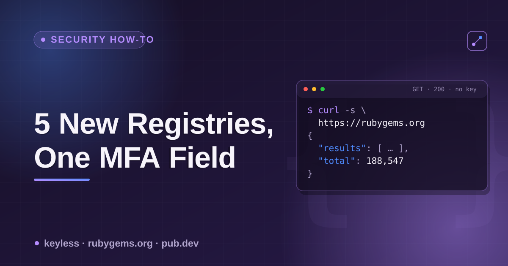

# package-mfa-signals

A cheatsheet for one specific question across eight package registries: **before you install
something, can you tell — keylessly, from public metadata alone — whether the account that can
push a new version has two-factor auth on, or is otherwise verified beyond a username and a
password?**

Companion piece (the conversational version, with the story of how this list grew from 3
registries to 8 in one week): [dev.to/ronin13 — My Sandbox Could Only Reach 3 Package Registries
for 16 Weeks. This Week It Reached 8](https://dev.to/ronin13/my-sandbox-could-only-reach-3-package-registries-for-16-weeks-this-week-it-reached-8).



## The answer, registry by registry

| registry | endpoint | field | what it tells you | verified live |
|---|---|---|---|---|
| **RubyGems** | `GET rubygems.org/api/v1/gems/{name}.json` | `metadata.rubygems_mfa_required` | boolean, **opt-in per gem** — a maintainer sets this in the gemspec. Not a download-tier mandate. | ✅ 17 gems checked |
| **pub.dev** | `GET pub.dev/api/packages/{name}/publisher` | `publisherId` | DNS-domain-verified identity (pub.dev's own verified-publisher program) — a different trust primitive than MFA: proves domain control, not 2FA status. | ✅ `http` → `dart.dev` |
| **npm** | `GET registry.npmjs.org/{name}/latest` | — none — | No MFA/2FA/verified-publisher field anywhere in the public registry JSON. Only `maintainers[].email` and `_npmUser`. | ✅ confirmed absent on 2 packages, full key dump |
| **PyPI** | `GET pypi.org/pypi/{name}/json` | `ownership.roles` | Structured owner list by username (`{"role":"Owner","user":"..."}`) — **new field, not covered in our prior maintainer-email piece**. No MFA/verification signal. | ✅ `requests` |
| **crates.io** | sparse index `index.crates.io/.../{name}` | — none — | No owner, no MFA field, nothing account-related in the sparse index at all. | ✅ (from prior pieces in this series) |
| **Packagist** | `GET packagist.org/packages/{vendor}/{name}.json` | `maintainers[]` | Name + Gravatar URL only. No verification of any kind. | ✅ `monolog/monolog` |
| **NuGet** | `GET api.nuget.org/v3/registration5-semver1/{name}/index.json` | — unknown — | The reachable registration API has no owner/MFA field in `catalogEntry`. The service that *might* (`azuresearch-usnc.nuget.org`, NuGet's real search/owners backend) is a **different host** and was blocked when this was checked. | ⚠️ partial — flagged, not guessed |
| **CocoaPods** | `GET trunk.cocoapods.org/api/v1/pods/{name}` | — unknown — | The real Trunk API was blocked when this was checked. `cocoapods.org` (the marketing site) answering 200 is **not** the same host and tells you nothing about the API. | ⚠️ not reachable — flagged, not guessed |

## Self-check script

```bash
#!/usr/bin/env bash
# usage: ./check-mfa.sh <gem-name>
name="${1:-rails}"
curl -s "https://rubygems.org/api/v1/gems/${name}.json" \
  | python3 -c "
import json,sys
d = json.load(sys.stdin)
mfa = d.get('metadata', {}).get('rubygems_mfa_required', '<absent>')
print(f\"{d['name']}: rubygems_mfa_required = {mfa}  (downloads: {d.get('downloads')})\")
"
```

```bash
# pub.dev verified-publisher check
curl -s "https://pub.dev/api/packages/${1:-http}/publisher"
```

## What surprised us: it's opt-in, not a popularity cutoff

Going in, the working assumption was "RubyGems forces MFA on the most-downloaded gems." The
flag doesn't support that. Checked against real download counts:

| gem | `rubygems_mfa_required` | downloads |
|---|---|---|
| `nokogiri` | `true` | 1.30B |
| `rspec` | `true` | 1.04B |
| `activesupport` | `true` | 1.48B |
| `thor` | `true` | 1.19B |
| `rails` | `true` | 817M |
| `rake` | **absent** | 1.47B |
| `bundler` | **absent** | 3.95B |
| `json` | **absent** | 1.44B |
| `aws-sdk` | **absent** | 386M |

`bundler` — the single most-downloaded package on the list, by a wide margin — carries no MFA
flag in its public metadata. The field is a gemspec setting a maintainer adds voluntarily, not
a threshold RubyGems applies from the top down. (It's possible some of these maintainers have
*account-level* 2FA on regardless — that's a separate RubyGems feature this field doesn't
report on — but the public API only tells you about the gem-level flag.)

## Why this matters

A maintainer account takeover is the actual mechanism behind most of the real supply-chain
incidents this series has tracked — Qix (Sept 2025), the Mastra ecosystem hijack (June 2026),
`eslint-config-prettier` (July 2025) — all phishing, all account credentials, none of them a
flaw in the package code itself. A per-package "this maintainer turned on 2FA" signal is the
closest thing to a leading indicator any of these registries expose publicly, and right now
exactly one of eight does it structurally (RubyGems) plus one more with a different mechanism
(pub.dev's domain-verified publisher). The other six — including the three biggest, npm, PyPI
and crates.io — give you nothing.

## Keyless npm / PyPI / crates.io in one actor

For the three registries this actually ships as a product:
[`package-registry-scraper`](https://apify.com/ponderable_hydrometer/package-registry-scraper)
normalizes npm, PyPI and crates.io into one row shape — version, license, repository,
dependency count, downloads. It does not cover RubyGems, pub.dev, Packagist, NuGet or
CocoaPods; those five are comparison data for this cheatsheet only, gathered directly against
each registry's own public API, not through the actor.

## Related, same series

- [`package-contact-exposure`](https://github.com/noble-ronin/package-contact-exposure) — maintainer email exposure (npm/PyPI live-checked; RubyGems' `owners.json` turns out to carry the same pattern — checked here for the first time)
- [`package-registry-apis`](https://github.com/noble-ronin/package-registry-apis) — the original npm/PyPI/crates.io field tour
